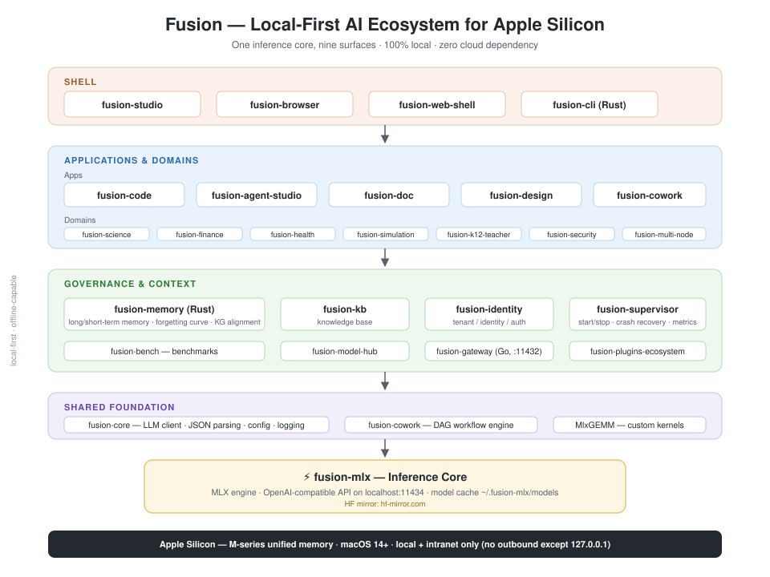

# Hi, I'm dahai80 👋

> **Fusion** — a local-first AI ecosystem for Apple Silicon ("one core, nine surfaces").
> One inference kernel driving 50+ sub-projects: from the engine to the desktop client,
> from coding to science.

[](https://github.com/dahai80)
[](https://github.com/dahai80)
[](https://github.com/dahai80)
[](https://github.com/dahai80)

## 📈 Stats

<p>
  
  
</p>

## 📌 Featured Repositories

<p>
  <a href="https://github.com/dahai80/fusion-mlx">
    
  </a>
  <a href="https://github.com/dahai80/fusion-memory">
    
  </a>
</p>
<p>
  <a href="https://github.com/dahai80/fusion-code">
    
  </a>
  <a href="https://github.com/dahai80/fusion-studio">
    
  </a>
</p>

---

## 🧠 What is Fusion?

Fusion is a **fully local AI ecosystem** running on Apple Silicon: model inference,
memory, knowledge base, and workflows all execute on the machine itself —
no cloud dependency, zero outbound traffic except 127.0.0.1.



<details>
<summary>Text version of the architecture (click to expand)</summary>

```
                    ┌─────────────────────┐
                    │   fusion-studio     │  SwiftUI unified desktop client
                    └──────────┬──────────┘
      ┌────────────┬───────────┼────────────┬────────────┐
 fusion-code  fusion-cowork  fusion-doc  fusion-science  …   Apps / domain layer
      └────────────┴───────────┼────────────┴────────────┘
                    ┌──────────┴──────────┐
                    │  fusion-memory / kb │  Memory · KB · Benchmarks
                    └──────────┬──────────┘
                    ┌──────────┴──────────┐
                    │     fusion-mlx      │  ⚡ Inference core (localhost:11434)
                    └─────────────────────┘
```

</details>

## 🗂 Project Layers at a Glance

| Layer | Projects | Description |
|---|---|---|
| **⚡ Core** | `fusion-mlx` | MLX inference engine, OpenAI-compatible API (port 11434), custom GEMM kernels |
| **🚪 Entry** | `fusion-cli` | Rust single-binary `fusion` command |
| **🏛 Platform** | `fusion-model-hub` · `fusion-kb` · `fusion-bench` · `fusion-plugins-ecosystem` | Model hub · Knowledge base · Benchmarks · Plugin ecosystem |
| **🧩 Governance** | `fusion-memory` · `fusion-identity` · `fusion-supervisor` · `fusion-gateway` | Cross-session memory hub · Tenant/identity · Process supervisor · API gateway |
| **🧪 Shared Foundation** | `fusion-core` · `fusion-cowork` | Common tech library · DAG workflow engine |
| **🛠 Applications** | `fusion-code` · `fusion-agent-studio` · `fusion-doc` · `fusion-design` · `fusion-studio` | Coding · Agents · Docs · Design · Desktop shell |
| **🔬 Domain** | `fusion-science` · `fusion-finance` · `fusion-health` · `fusion-simulation` · `fusion-k12-teacher` · `fusion-security` · `fusion-multi-node` · … | Vertical domain apps |

## ✨ Highlights

- 🔋 **100% local** — models, memory, and knowledge base stay on-device / intranet-only
- 🧠 **Cognitive graph memory** — `fusion-memory`: long/short-term memory + forgetting curve + KG alignment, written in Rust, exposed via UDS / HTTP / PyO3
- 🔀 **DAG workflows** — `fusion-cowork` with a lazy-import node system and Chinese-friendly aliases
- 🖥 **One core, nine surfaces** — a single inference kernel driving desktop, CLI, web, and domain clients
- ⚙️ **50+ independent repos** — one shared venv, each sub-project builds and ships on its own

## 📊 Tech Stack

`Python 3.12` · `Rust` · `Swift/SwiftUI` · `TypeScript/Bun` · `Go` · `MLX` · `FastAPI` · `gRPC` · `SQLite` · `PyBullet`

## 📫 Reach Me

- GitHub: [@dahai80](https://github.com/dahai80)

---

<details>
<summary>🌱 Full sub-project list (click to expand)</summary>

fusion-agent-studio · fusion-artifacts-engine · fusion-autotest · fusion-bench · fusion-browser · fusion-cli · fusion-code · fusion-comfyui · fusion-core · fusion-cowork · fusion-design · fusion-doc · fusion-drama · fusion-ecommerce · fusion-event · fusion-executor · fusion-finance · fusion-game · fusion-gateway · fusion-guard · fusion-health · fusion-identity · fusion-k12-teacher · fusion-memory · fusion-mlx · fusion-model-hub · fusion-multi-node · fusion-musetalk · fusion-ninfer · fusion-plugins-ecosystem · fusion-projects · fusion-rag · fusion-robot · fusion-science · fusion-security · fusion-simulation · fusion-store · fusion-studio · fusion-supervisor · fusion-trainer · fusion-web-shell

</details>
